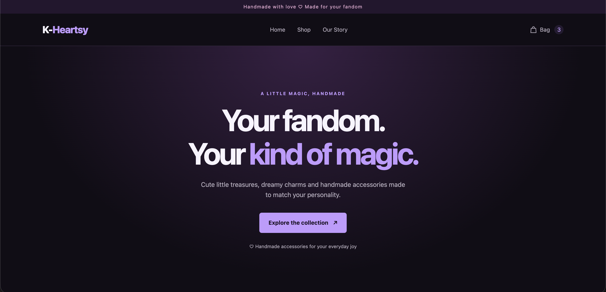
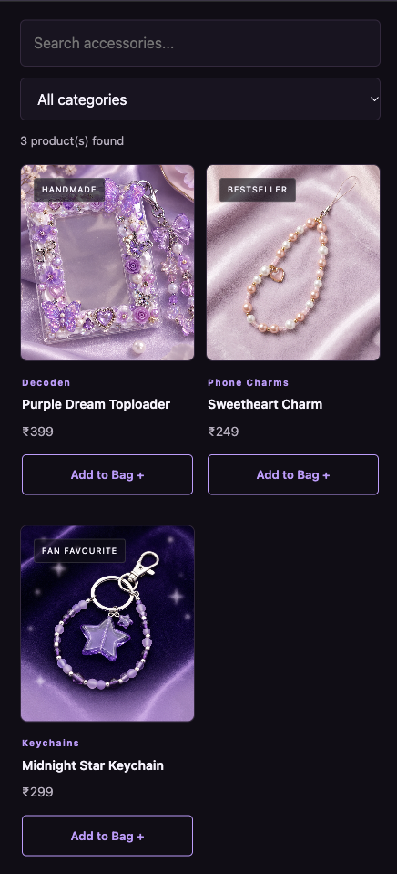
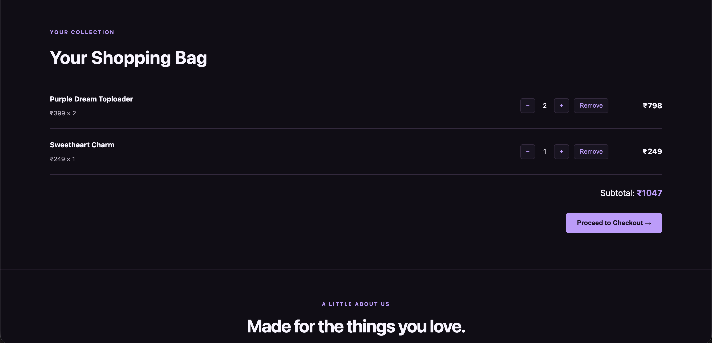

# K-Heartsy Commerce

A responsive e-commerce storefront for K-Heartsy, a handmade accessories brand inspired by K-pop, anime, and fandom culture.

The project showcases a product collection, interactive shopping bag, persistent cart state, and a demo checkout experience, built with HTML, CSS, and JavaScript.

## Live Demo

**[View K-Heartsy Commerce](https://swag-codes.github.io/k-heartsy-commerce/)**

Explore the live storefront, browse products, filter categories, manage the shopping bag, and try the demo checkout.

## Preview

### Desktop Homepage



### Mobile Product Collection



### Shopping Bag



## Features

- Browse a collection of handmade accessories
- Search products and filter by category
- View product details in a modal
- Add products to the shopping bag
- Increase, decrease, and remove cart items
- Save cart contents using localStorage
- View the subtotal and complete a demo checkout
- Responsive layout for desktop and mobile screens
- Shopping bag quantity animation and add-to-cart notifications


## Technologies Used

- **HTML5** — page structure and content
- **CSS3** — styling, responsive layouts, animations, and visual design
- **JavaScript (Vanilla)** — product rendering, search, filtering, cart logic, and checkout interactions
- **localStorage** — persistence of shopping bag contents between page reloads
- **Git and GitHub** — version control and source code hosting
- **Visual Studio Code** — development environment

## Getting Started

### Prerequisites

- A modern web browser
- Visual Studio Code
- The Live Server extension for Visual Studio Code (recommended)

### Run Locally

1. Clone or download this repository.
2. Open the project folder in Visual Studio Code.
3. Install the Live Server extension if it is not already installed.
4. Open `index.html`.
5. Right-click inside the editor and select **Open with Live Server**.

The website should open in your browser.

## Project Structure

```text
k-heartsy-commerce/
├── index.html
├── style.css
├── script.js
└── k-heartsy-commerce/
    └── images/
        ├── purple-dream-toploader.png
        ├── sweetheart-charm.png
        └── midnight-star-keychain.png
```

## Notes

- This is a front-end portfolio project.
- Checkout is a demo experience; it does not process real payments.
- Shopping bag contents are stored in the browser using localStorage.
